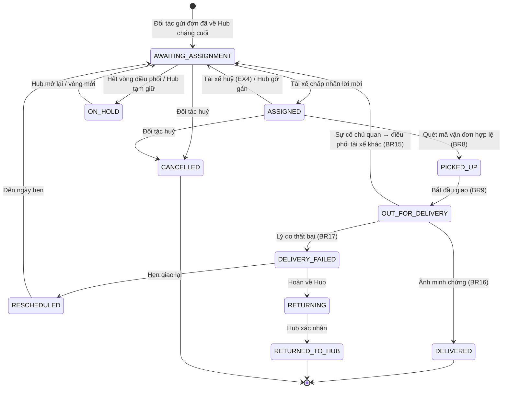
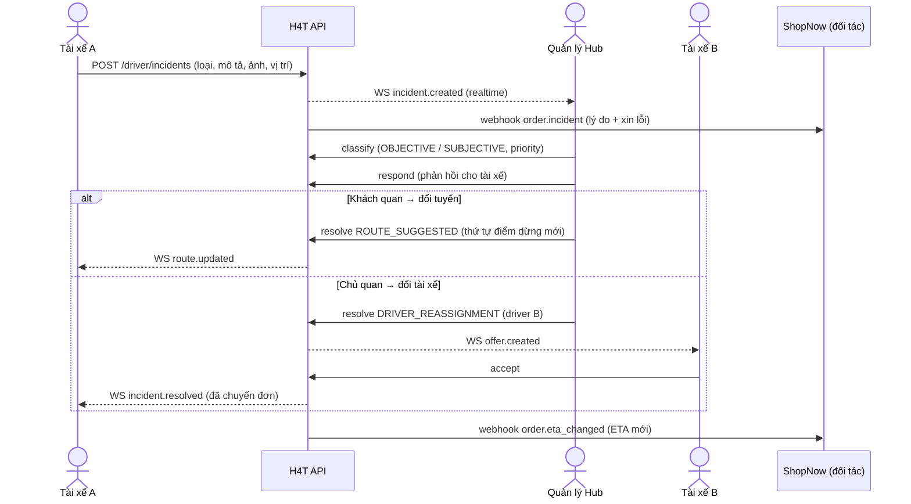

# H4T Xpress — Đặc tả sản phẩm (Product Specification)

> Hệ thống quản lý và tối ưu hoá giao hàng chặng cuối, tập trung vào **xử lý sự cố giao hàng**.
> Bản hiện thực hoá đồ án PTTKHTTT (Nhóm 11, UEL) thành ứng dụng web chạy được, dùng làm dự án portfolio.

| Mục | Giá trị |
|---|---|
| Phiên bản | 1.0 (bản chốt sau phỏng vấn yêu cầu) |
| Ngày | 24/10/2026 |
| Tài liệu nguồn | Báo cáo đồ án cuối kỳ (83 trang), Project Planning, Requirements Elicitation, `BA_DrawIO_Nhóm 11` (BPMN ×2, DFD, Use Case, Activity, Sequence, Class, ERD), Figma *Phân tích thiết kế HTTT (BA)* (3 trang, 40 frame) |
| Thời lượng | 2–3 tuần |

Quy ước trong tài liệu:
- `FR-…`, `BR…`, `EX…`, `UC-…`, `NFR-…` là mã yêu cầu **giữ nguyên từ báo cáo gốc** để truy vết.
- **[Mới]** là phần bổ sung so với báo cáo hoặc Figma. **[Đổi]** là chỗ khác với thiết kế gốc, kèm lý do.
- Mức ưu tiên dùng MoSCoW: **M** (Must), **S** (Should), **C** (Could), **W** (Won't, không làm ở bản này).

---

## Mục lục

1. [Tổng quan và các quyết định đã chốt](#1-tổng-quan-và-các-quyết-định-đã-chốt)
2. [Vai trò và phân quyền](#2-vai-trò-và-phân-quyền)
3. [Nghiệp vụ cốt lõi (áp dụng cho cả BE/FE/DB)](#3-nghiệp-vụ-cốt-lõi)
4. [Frontend](#4-frontend)
5. [Backend](#5-backend)
6. [Database](#6-database)
7. [Giả lập và chế độ demo](#7-giả-lập-và-chế-độ-demo)
8. [Yêu cầu phi chức năng](#8-yêu-cầu-phi-chức-năng)
9. [Ma trận truy vết yêu cầu](#9-ma-trận-truy-vết-yêu-cầu)
10. [Kế hoạch triển khai 3 tuần](#10-kế-hoạch-triển-khai-3-tuần)
11. [Cấu trúc repo và quy ước](#11-cấu-trúc-repo-và-quy-ước)
12. [Rủi ro, giả định và câu hỏi mở](#12-rủi-ro-giả-định-và-câu-hỏi-mở)
13. [Ghi công](#13-ghi-công)

---

## 1. Tổng quan và các quyết định đã chốt

### 1.1. Bài toán (tóm tắt từ báo cáo)

Khi đơn hàng chặng cuối gặp sự cố (kẹt xe, thời tiết, hỏng xe, tài xế ốm…), thông tin bị đứt đoạn. Tài xế không có kênh báo cáo chuẩn, Quản lý Hub mất 15–20 phút gọi điện tìm tài xế thay thế, còn khách hàng không nhận được ETA mới và lý do trễ. H4T Xpress giải quyết bằng cách:

1. Cho **tài xế** báo sự cố và cập nhật trạng thái/ETA nhanh ngay trên điện thoại.
2. Cho **Quản lý Hub** thấy sự cố theo thời gian thực, phân loại khách quan/chủ quan, rồi **đổi tuyến** hoặc **điều phối tài xế khác** có hệ thống gợi ý.
3. **Tự động đồng bộ** trạng thái, ETA mới và lời xin lỗi sang sàn TMĐT đối tác để báo cho khách hàng.
4. Cho **Nhà quản trị** xem báo cáo tỷ lệ thành công, đúng hạn, nguyên nhân thất bại theo Hub và tài xế, và xuất file.

### 1.2. Mục tiêu của dự án portfolio

- Người dùng: ứng viên vị trí **Business Analyst**. Repo phải chứng minh hai điều: (a) phân tích nghiệp vụ bài bản, (b) **sản phẩm chạy được thật**: có link demo, giao diện hoàn chỉnh, flow mượt.
- Người xem repo (nhà tuyển dụng) phải làm được 3 việc trong 3 phút: mở link demo → bấm đăng nhập nhanh theo vai trò → chạy hết kịch bản sự cố (mục 7.3).
- Ai có Docker cũng chạy được toàn bộ hệ thống trên máy mình bằng 1 lệnh `docker compose up` (mục 5.11), kể cả khi link demo đang ngủ.
- Thư mục `docs/` giữ toàn bộ sản phẩm BA (BPMN, ERD, Use Case, ma trận truy vết) để chứng minh code đi ra từ phân tích.

### 1.3. Các quyết định đã chốt

| # | Chủ đề | Quyết định | Lý do / ghi chú |
|---|---|---|---|
| D1 | Nền tảng | **Web app + PWA**: Hub/Admin là dashboard desktop; màn Tài xế mobile-first, cài được như app | Một codebase, người xem chỉ cần mở link |
| D2 | Frontend | React 18 + TypeScript + Vite + Tailwind CSS | |
| D3 | Backend | **FastAPI (Python 3.12)**, SQLAlchemy 2 (async), Alembic | Báo cáo đề xuất FastAPI; người làm quen Python |
| D4 | Database | **PostgreSQL 16** | ERD của nhóm là mô hình quan hệ |
| D5 | Phạm vi | **MVP luồng sự cố** (mục 1.4) | Vừa với 2–3 tuần |
| D6 | Thiết kế | **Chuẩn hoá thành 1 design system**: giữ bố cục từng màn như Figma, gộp về 1 bộ màu, font, component | Figma có 3 tông xanh và 1 nhóm màn tím; báo cáo mục 3.4 yêu cầu "Consistency" |
| D7 | Ngôn ngữ UI | **Tiếng Anh** (khớp Figma). README song ngữ Anh/Việt | |
| D8 | Bản đồ | **Leaflet + OpenStreetMap + OSRM** | Miễn phí, không cần API key |
| D9 | Điều phối | **Làm thật** thuật toán BR4–BR8: lọc, chấm điểm, mời lần lượt, timeout | Điểm nhấn kỹ thuật chính |
| D10 | Phân quyền | **4 vai trò, ma trận quyền lưu DB, chỉnh được qua UI** | Đúng FR-A-02 |
| D11 | OTP | **Giả lập**: đủ luồng (sinh mã, hết hạn, giới hạn số lần) nhưng mã hiện ở banner demo thay vì gửi SMS | Miễn phí, không bị spam tốn tiền |
| D12 | Hosting | **Free tier**: Vercel (FE) + Render chạy **Docker image** của API + Neon (Postgres) + Cloudinary (ảnh) | Chấp nhận cold start; README có GIF/video |
| D13 | Thư mục | `D:\h4t-xpress`, repo git riêng | |
| D14 | Thương hiệu | Sản phẩm là **H4T Xpress**; sàn TMĐT giả lập tên **ShopNow**; bỏ mọi tên và logo Shopee/SPX | Repo công khai, tránh dùng thương hiệu thật |
| D15 | Đóng gói | **Docker**: mỗi service một Dockerfile multi-stage; `docker compose up` chạy toàn bộ hệ thống (Postgres + API + Web) bằng 1 lệnh; CI build và đẩy image lên GitHub Container Registry | Người xem chạy được local mà không cần cài Python/Node/Postgres; image chạy local và trên Render là một (§5.11) |

### 1.4. Phạm vi

**Trong phạm vi (MVP):** toàn bộ **Quy trình 2 – Theo dõi và giao đơn hàng chặng cuối** (BPMN 2) cùng subprocess điều phối tài xế (lấy từ BPMN 1), gồm:

| Nhóm | Chức năng |
|---|---|
| Xác thực & phân quyền | Đăng ký tài xế + OTP, đăng nhập email/SĐT, quên mật khẩu, RBAC 4 vai trò |
| Tài xế | Đăng ký ca, bật/tắt nhận đơn, nhận/từ chối lời mời, xem tuyến và chi tiết đơn, quét mã vận đơn, cập nhật trạng thái, giao thành công kèm ảnh, giao thất bại kèm lý do, báo sự cố, cập nhật ETA |
| Quản lý Hub | Dashboard thời gian thực, theo dõi giao hàng trên bản đồ, quản lý sự cố (phân loại → phản hồi → đổi tuyến hoặc điều phối tài xế khác), lập/tối ưu tuyến |
| Nhà quản trị | Báo cáo thống kê có lọc, xuất Excel/PDF |
| Quản trị viên hệ thống | Quản lý tài khoản, ma trận quyền, Hub/khu vực/ca làm, cấu hình tham số điều phối |
| Hệ thống | Tự động gán tài xế, tính lại ETA, đồng bộ trạng thái sang đối tác (webhook), thông báo realtime |
| Giả lập | Sàn TMĐT ShopNow (tạo đơn, nhận webhook, trang tra cứu cho khách), GPS di chuyển của tài xế |

**Ngoài phạm vi bản này (W):** chặng lấy hàng từ Shop về Hub (BPMN 1, bước 1–5), Hub nhập kho/phân loại (FR-H-04, FR-H-06), xử lý hàng lỗi (FR-H-05), sao lưu/phục hồi qua UI (FR-A-05), 2FA, app native, tích hợp sàn thật, SMS thật, dữ liệu giao thông thời gian thực. Riêng thuật toán điều phối được viết dùng chung cho cả hai chặng, nên mở rộng sang chặng lấy hàng sau này không phải viết lại.

---

## 2. Vai trò và phân quyền

### 2.1. Vai trò

| Mã vai trò | Tên trong báo cáo | Giao diện | Phạm vi dữ liệu |
|---|---|---|---|
| `DRIVER` | Tài xế giao hàng | `/driver` (mobile PWA) | Chỉ đơn, tuyến, sự cố **của chính mình** |
| `HUB_MANAGER` | Quản lý Hub | `/hub` (desktop) | Chỉ dữ liệu của **Hub mình phụ trách** (`users.hub_id`) |
| `EXECUTIVE` | Nhà quản trị | `/reports` (desktop) | Đọc số liệu tổng hợp **toàn hệ thống**, không sửa dữ liệu vận hành |
| `SYSTEM_ADMIN` | Quản trị viên hệ thống | `/admin` (desktop) | Cấu hình hệ thống, tài khoản, quyền; không thao tác vận hành |

Khách hàng và Chủ shop **không có tài khoản** trong H4T. Họ nhận thông tin gián tiếp qua đối tác (đúng mục 1.4.1 báo cáo); trong bản demo, vai trò này do trang tra cứu của ShopNow đảm nhận (mục 7.1).

### 2.2. Danh mục quyền và ma trận mặc định

Backend kiểm tra **theo mã quyền**, không theo tên vai trò. System Admin chỉnh ma trận này trên màn *Roles & Permissions*.

| Mã quyền | Mô tả | DRIVER | HUB_MANAGER | EXECUTIVE | SYSTEM_ADMIN |
|---|---|:-:|:-:|:-:|:-:|
| `shift.register` | Đăng ký/huỷ ca làm | ✓ | | | |
| `availability.toggle` | Bật/tắt nhận đơn | ✓ | | | |
| `offer.respond` | Chấp nhận/từ chối lời mời | ✓ | | | |
| `order.update_own` | Quét mã, cập nhật trạng thái, giao/thất bại đơn của mình | ✓ | | | |
| `eta.update_own` | Cập nhật ETA thủ công | ✓ | | | |
| `incident.report` | Báo sự cố | ✓ | | | |
| `hub.dashboard.view` | Xem dashboard Hub | | ✓ | | |
| `order.view_hub` | Xem đơn của Hub | | ✓ | | |
| `order.reassign` | Điều phối lại tài xế | | ✓ | | |
| `route.plan` | Lập/tối ưu/sắp xếp tuyến | | ✓ | | |
| `incident.manage` | Phân loại, phản hồi, giải quyết sự cố | | ✓ | | |
| `driver.view_hub` | Xem tài xế và vị trí thuộc Hub | | ✓ | | |
| `report.view` | Xem báo cáo | | ✓ (chỉ Hub mình) | ✓ | |
| `report.export` | Xuất Excel/PDF | | | ✓ | |
| `user.manage` | Tạo/sửa/khoá tài khoản | | | | ✓ |
| `role.manage` | Sửa ma trận quyền | | | | ✓ |
| `hub.manage` | Quản lý Hub, khu vực, ca làm | | | | ✓ |
| `settings.manage` | Sửa tham số điều phối, ETA, SLA | | | | ✓ |
| `audit.view` | Xem nhật ký hệ thống | | | | ✓ |

Quy tắc bảo vệ:
- Không được gỡ `role.manage` khỏi vai trò `SYSTEM_ADMIN` cuối cùng, để tránh tự khoá hệ thống.
- Quyền đọc dữ liệu luôn đi kèm **kiểm tra phạm vi**: Hub Manager gọi API đơn của Hub khác nhận `404`, không phải `403`, để không lộ sự tồn tại của dữ liệu.
- Ma trận quyền được cache trong token. Khi System Admin sửa quyền, token cũ hết hiệu lực sau tối đa 15 phút (thời hạn access token); có nút "Force re-login" cho vai trò bị đổi.

### 2.3. Tài khoản demo (seed)

| Vai trò | Đăng nhập | Ghi chú |
|---|---|---|
| Driver | `driver1@demo.h4t` … `driver30@demo.h4t` | 30 tài xế, chia đều 3 Hub |
| Hub Manager | `hub.dian@demo.h4t`, `hub.linhxuan@demo.h4t`, `hub.thuduc@demo.h4t` | |
| Executive | `exec@demo.h4t` | |
| System Admin | `admin@demo.h4t` | |

Mật khẩu demo chung đặt trong `.env.example`. Trang đăng nhập có khối **"Quick demo login"** gồm 4 nút theo vai trò, chỉ hiện khi `DEMO_MODE=true`.

---

## 3. Nghiệp vụ cốt lõi

Phần này là "luật" chung mà cả Backend, Frontend và Database phải tuân theo.

### 3.1. Máy trạng thái đơn hàng



| Trạng thái | Nhãn hiển thị (EN) | Nhãn trong báo cáo |
|---|---|---|
| `AWAITING_ASSIGNMENT` | Awaiting driver | Chờ phân công tài xế |
| `ON_HOLD` | On hold at hub | Chờ xử lý tại kho |
| `ASSIGNED` | Driver assigned | Đã gán tài xế |
| `PICKED_UP` | Picked up | Đã nhận hàng (tại Hub hoặc tại điểm bàn giao) |
| `OUT_FOR_DELIVERY` | Out for delivery | Đang giao hàng |
| `DELIVERED` | Delivered | Giao thành công |
| `DELIVERY_FAILED` | Delivery failed | Giao không thành công |
| `RESCHEDULED` | Rescheduled | Lên lịch giao lại |
| `RETURNING` / `RETURNED_TO_HUB` | Returning / Returned | Chuyển về Hub hoàn hàng |
| `CANCELLED` | Cancelled | Đối tác huỷ |

Quy tắc:
- **BR3:** chỉ cho phép đúng các chuyển trạng thái trong sơ đồ, không nhảy cóc và không đi ngược. Backend từ chối bằng `409 INVALID_TRANSITION`.
- Mỗi lần chuyển trạng thái ghi 1 dòng `order_events` (ai, lúc nào, toạ độ GPS, ghi chú). **UC-05** yêu cầu luôn ghi thời gian và vị trí GPS.
- Đơn ở `DELIVERED` không cho cập nhật thêm (ngoại lệ của UC-05).
- **Bàn giao khi đổi tài xế [Mới]:** khi đơn bị điều phối lại giữa đường, hàng đang nằm ở tài xế A. Tài xế B nhận đơn (`ASSIGNED`), đến điểm sự cố, quét mã vận đơn để xác nhận nhận hàng (`PICKED_UP`), rồi bắt đầu giao (`OUT_FOR_DELIVERY`). Đơn mang cờ `handover_from_driver_id` để UI hiển thị "Pick up from driver A at …" thay vì "Pick up at hub".
- **Gom điểm giao:** nhiều đơn cùng người nhận và cùng địa chỉ trong một tuyến được gom thành **1 điểm dừng** (`route_stops`), đúng màn *Order Details* trên Figma ("Delivery Requests (02)"). Trạng thái vẫn theo từng đơn.

### 3.2. Thuật toán điều phối tài xế (BR4–BR8, EX1–EX4)

Dùng chung cho 3 tình huống: (a) đơn mới về Hub, (b) đơn được mở lại sau thất bại hoặc hẹn giao lại, (c) điều phối lại khi có sự cố chủ quan.

**Bước 1 – Lọc tài xế khả dụng (BR4 / BR3 quy trình 2).** Tài xế đạt **tất cả** điều kiện:
1. Tài khoản `ACTIVE`, vai trò `DRIVER`.
2. Có `shift_registrations` cho hôm nay và ca đó đang diễn ra hoặc giao với khung giờ giao dự kiến.
3. `availability = ONLINE` (đã bật "Sẵn sàng nhận đơn").
4. Đã gửi vị trí GPS trong 10 phút gần nhất, tức là đang mở app.
5. Thuộc khu vực của Hub, hoặc khu vực kề (`area_adjacency`).
6. Số đơn đang giữ (`ASSIGNED` + `PICKED_UP` + `OUT_FOR_DELIVERY`) < `max_active_orders` (mặc định 20).
7. Không có lời mời nào khác đang chờ phản hồi.
8. Chưa từ chối hoặc để hết hạn lời mời của **chính đơn này** trong vòng hiện tại.

**Bước 2 – Chấm điểm (BR5).** Điểm từ 0 đến 100, các trọng số lưu trong `system_settings`:

| Tiêu chí | Công thức (chuẩn hoá về 0..1) | Trọng số mặc định |
|---|---|:-:|
| Khoảng cách | `max(0, 1 − d_km / 15)`, với `d` là khoảng cách haversine từ tài xế đến điểm lấy hàng (Hub hoặc điểm bàn giao) | 0.40 |
| Tải đơn hiện tại | `1 − active_orders / max_active_orders` | 0.25 |
| Hiệu suất lịch sử | `0.7 × on_time_rate_30d + 0.3 × (1 − incident_rate_30d)`; tài xế mới mặc định 0.8 | 0.20 |
| Phù hợp thời gian | `1` nếu thời gian còn lại của ca ≥ thời gian giao ước tính, ngược lại là tỷ lệ | 0.15 |

Chỉ tính haversine cho bước lọc và chấm điểm để đạt NFR-01 (< 5 giây). OSRM chỉ được gọi để tính ETA cho **tài xế đã chấp nhận**.

**Bước 3 – Mời lần lượt (BR6–BR8).**
- Gửi lời mời cho **1 tài xế tại một thời điểm**, theo thứ tự điểm từ cao xuống thấp; tối đa `max_candidates_per_round` người mỗi vòng (mặc định 5).
- Mỗi lời mời có hạn `offer_timeout` (**10 phút**; chế độ demo **30 giây**). Hết hạn được coi là từ chối (BR7).
- Tài xế chấp nhận → đơn sang `ASSIGNED`, vòng điều phối dừng (BR8), tính ETA, gửi webhook `order.driver_assigned` sang đối tác.
- **EX2 / EX3 (không có ai / tất cả từ chối):** đơn giữ `AWAITING_ASSIGNMENT`, hệ thống cảnh báo Hub và mở vòng mới sau `round_retry_delay` (5 phút). Sau `max_rounds` vòng (mặc định 3) thì đơn chuyển `ON_HOLD` và tạo cảnh báo mức High trên dashboard Hub.
- **EX4 (tài xế đã nhận nhưng huỷ):** chỉ được huỷ trước `PICKED_UP`, bắt buộc có lý do. Đơn quay về `AWAITING_ASSIGNMENT` và khởi động lại từ bước 1.

**Điều phối tay [UC-04]:** Hub Manager mở danh sách ứng viên đã xếp hạng quanh vị trí sự cố (có khoảng cách và số đơn đang giữ, đúng "Yêu cầu đặc biệt" của UC-04), chọn tài xế B, rồi xác nhận qua popup. Thao tác này gửi **lời mời trực tiếp** cho B, vẫn có timeout. B từ chối thì quay lại danh sách ứng viên.

**Ràng buộc tranh chấp:** mỗi đơn có tối đa 1 lời mời `PENDING` (unique index có điều kiện). Khi chấp nhận, backend khoá dòng lời mời (`SELECT … FOR UPDATE`) và kiểm tra chưa hết hạn, nên không thể có 2 tài xế cùng nhận một đơn.

### 3.3. ETA và SLA

- **Cách tính:** `ETA = now + Σ(thời lượng OSRM giữa các điểm còn lại theo thứ tự tuyến) × traffic_factor(giờ) + service_time × số điểm dừng còn lại`.
  - `traffic_factor`: bảng theo khung giờ (07–09h và 16–19h là 1.5, các giờ khác 1.1), cấu hình được. README ghi rõ đây là **hệ số ước lượng, không phải dữ liệu giao thông thật**.
  - `service_time` mặc định 5 phút mỗi điểm dừng.
- **Tần suất tính lại:** mỗi khi có vị trí GPS mới, giới hạn tối đa 30 giây một lần cho mỗi tuyến (theo mô tả BPMN 1 bước 4).
- **Tài xế cập nhật tay (màn "Update ETA" trên Figma):** chọn giờ mới và lý do. ETA chuyển `source = MANUAL` và được giữ cho đến khi tài xế đến điểm dừng đó hoặc Hub ghi đè.
- **Khi nào thông báo đối tác (BR11):** lúc bắt đầu giao, khi còn ≤ 1 điểm dừng ("sắp đến"), khi ETA thay đổi ≥ 15 phút, và khi có sự cố. Thông báo sự cố kèm lý do và câu xin lỗi soạn sẵn theo loại sự cố.
- **SLA:** mỗi đơn có `promised_at` do đối tác gửi. Đơn **trễ** khi giao sau `promised_at + sla_grace` (mặc định 2 giờ, theo mục 2.5 báo cáo: "trễ là quá 2 giờ so với cam kết"). Dashboard tô **đỏ** đơn đã hoặc sẽ trễ (ETA > hạn) và **xanh** đơn đúng tiến độ (theo UC-02).
- **Dự phòng khi OSRM lỗi (NFR-04):** dùng `haversine × 1.4 / tốc độ trung bình 25 km/h`, đánh dấu `eta_degraded = true`; các luồng nhận đơn và cập nhật trạng thái vẫn chạy bình thường.

### 3.4. Xử lý sự cố (luồng chính của sản phẩm)



**Phía tài xế** (theo logic If-Else mục 4.1.4.1 báo cáo):
- Bắt buộc có **loại sự cố**, **mô tả**, **ít nhất 1 ảnh minh chứng**. Thiếu thì báo "Please describe the incident and attach evidence".
- Loại sự cố: `TRAFFIC_JAM`, `WEATHER`, `TRAFFIC_ACCIDENT`, `VEHICLE_BREAKDOWN`, `HEALTH`, `GOODS_DAMAGED`, `OTHER`.
- Một sự cố gắn với 1 hoặc nhiều đơn tài xế đang giữ (mặc định là tất cả đơn `OUT_FOR_DELIVERY`).
- Hệ thống tự gợi ý phân loại: kẹt xe và thời tiết là **khách quan**; sức khoẻ và hỏng xe là **chủ quan**; tai nạn để trống cho Hub quyết định.

**Phía Quản lý Hub** (các bước bắt buộc theo thứ tự, đúng If-Else báo cáo):
1. **Phân loại**: `OBJECTIVE` hoặc `SUBJECTIVE`, cùng mức ưu tiên `HIGH` / `MEDIUM` / `LOW`. Mức gợi ý mặc định là HIGH nếu có đơn hoả tốc hoặc ETA đã vượt hạn SLA.
2. **Nhập phản hồi** gửi cho tài xế.
3. **Chọn giải pháp** rồi bấm **Resolve**:
   - `ROUTE_SUGGESTED` (UC-03): mở màn bản đồ với tuyến OSRM tối ưu mới. Hub có thể **kéo thả** để sắp lại thứ tự (luồng thay thế 4a), rồi xác nhận gửi xuống tài xế.
   - `DRIVER_REASSIGNMENT` (UC-04): mở màn điều phối, chọn tài xế B, xác nhận qua popup. Cho phép **chỉ chuyển các đơn hoả tốc** (luồng 5a), các đơn còn lại tài xế A tiếp tục giao hoặc chuyển `ON_HOLD`.
   - `HOLD_AT_HUB` [Mới, theo luồng 4a của UC-04]: không có tài xế dự phòng thì chuyển đơn về `ON_HOLD`.
4. Thiếu bước nào thì UI chặn và hiện đúng thông báo của báo cáo ("Please classify the incident", "Please enter a response", "Please choose a solution").

Trạng thái sự cố: `OPEN → IN_REVIEW → RESOLVING → RESOLVED` (hoặc `CLOSED_NO_ACTION`). `RESOLVING` nghĩa là đã chọn giải pháp nhưng đang chờ, ví dụ chờ tài xế B chấp nhận.

**Phát hiện bất thường tự động (BR12, EX5, EX6) [S]:** hệ thống tự tạo sự cố `source = SYSTEM` khi:
- ETA tăng liên tục 3 lần và tổng cộng tăng ≥ 30 phút trong vòng 30 phút (`ETA_ANOMALY`), hoặc
- tài xế ở `OUT_FOR_DELIVERY` mà vị trí di chuyển < 50 m trong 15 phút (`DRIVER_IDLE`).

### 3.5. Giao thất bại và giao lại

- Lý do bắt buộc (6b của UC-05 và màn Report trên Figma): `CUSTOMER_REFUSED`, `CUSTOMER_UNREACHABLE`, `CUSTOMER_ABSENT`, `WRONG_ADDRESS`, `OTHER` (kèm ghi chú).
- Tài xế có thể đề xuất **ngày giao lại** (trường "Expected new delivery date" trên Figma).
- Sau khi thất bại: có ngày đề xuất thì đơn sang `RESCHEDULED`, đến ngày đó tự động quay về `AWAITING_ASSIGNMENT`. Không có ngày, hoặc đã thất bại `max_attempts` lần (mặc định 3), thì sang `RETURNING`. Hub có thể ghi đè lựa chọn này **[S]**.

### 3.6. Đăng ký ca làm (UC-01)

- Ca mặc định: `MORNING` (07–12h), `AFTERNOON` (13–18h), `FULL_DAY` (07–18h). System Admin cấu hình được, mỗi ca có `capacity` theo Hub.
- Đăng ký trước tối đa 7 ngày, hạn chót là `shift_cutoff` trước giờ bắt đầu ca (mặc định 06:00 cùng ngày, theo BPMN 1).
- Từ chối khi ca đã đủ người, khi trùng giờ với ca đã đăng ký, hoặc khi ca đã qua hạn (luồng 4a của UC-01).

### 3.7. Đồng bộ với đối tác (FR-S-01..03, FR-J-03, BR10)

- **Chiều vào:** `POST /partner/v1/orders` xác thực bằng API key. Kiểm tra đủ trường bắt buộc (BR2: mã vận đơn, địa chỉ lấy/giao, khối lượng, kích thước, `promised_at`) và chống trùng theo `(partner_id, waybill_code)`. Lỗi trả `422` kèm danh sách trường sai (EX1).
- **Chiều ra:** mọi thay đổi quan trọng ghi vào bảng outbox `webhook_deliveries` **trong cùng transaction** với thay đổi dữ liệu. Worker gửi đi kèm chữ ký HMAC-SHA256, thử lại với backoff 1 → 5 → 30 phút, tối đa 6 lần, và lưu log để xử lý EX7 / EX11.
- Các sự kiện: `order.driver_assigned`, `order.status_changed`, `order.eta_changed`, `order.incident`, `order.delivered` (kèm URL ảnh), `order.failed`.

---

## 4. Frontend

### 4.1. Công nghệ

| Hạng mục | Lựa chọn |
|---|---|
| Khung | React 19, TypeScript 6 (strict), Vite 8. Chưa dùng TypeScript 7 vì typescript-eslint chưa hỗ trợ |
| Routing / data | React Router 8, TanStack Query (cache, refetch 60 giây cho dashboard theo UC-02), Zustand (phiên đăng nhập) |
| UI | Tailwind CSS 4 + bộ component tự viết trong `components/ui` theo token mục 4.2; **không dùng thư viện icon** (chỉ chữ, huy hiệu màu, công tắc) |
| Form | Form có kiểm soát + hàm kiểm tra trong `features/*/validation.ts`, cùng luật với API (kiểm tra trước khi submit, theo "Error Prevention" mục 3.4) |
| Bản đồ | react-leaflet + OSM tiles; polyline tuyến từ OSRM |
| Biểu đồ | Recharts |
| Kéo thả | dnd-kit (sắp xếp điểm dừng) |
| Quét mã | `@zxing/browser` (camera) + ô nhập tay dự phòng |
| PWA | vite-plugin-pwa: manifest, icon, cache app shell; chỉ cài được ở nhóm route `/driver` |
| Test | Vitest + Testing Library; Playwright cho 3 luồng E2E (mục 5.10) |

### 4.2. Design system (chuẩn hoá từ Figma)

Đo từ ảnh chụp Figma: màn Tài xế dùng xanh `#0060F8`, Hub `#1070F8`, Admin `#4078F8`; nhóm màn "SPX LEAD" dùng tím. Theo D6, gộp lại như sau (giá trị chính xác sẽ đối chiếu bằng `get_design_context` khi dựng màn đầu tiên):

| Token | Giá trị đề xuất | Dùng cho |
|---|---|---|
| `primary-600` | `#1070F8` | Nút chính, link, trạng thái đang chọn |
| `primary-700` | `#0B5AD0` | Hover/pressed |
| `primary-50` | `#EAF2FF` | Nền chip, hàng được chọn |
| `success` | `#22C55E` | Giao thành công, đúng tiến độ |
| `warning` | `#F59E0B` | Có nguy cơ trễ, mức Medium |
| `danger` | `#EF4444` | Trễ, sự cố High, lỗi |
| `neutral-*` | thang xám 50–900 | Chữ, viền, nền |
| Bo góc | 4 px (ô nhập), 10 px (nút), 12 px (card), 16 px (bottom sheet) | Lấy từ frame đăng nhập trên Figma (ô nhập cao 52 px, nút cao 50 px) |
| Font | Montserrat (tiêu đề, màn tài xế) + Inter (nội dung, số liệu) | Đã đối chiếu Figma: màn đăng nhập dùng Montserrat, trang Hub dùng Roboto; Poppins không có đủ dấu tiếng Việt |
| Breakpoint | Driver: thiết kế ở 390 px; Hub/Admin: tối thiểu 1280 px, vẫn dùng được ở 1024 px | NFR-07 |

Component dùng chung: `Button`, `Input`, `Select`, `DatePicker`, `StatusBadge` (màu theo trạng thái đơn và sự cố), `KpiCard`, `DataTable` (lọc, sắp xếp, phân trang), `MapView`, `Timeline` (lịch sử đơn), `BottomSheet` (form sự cố trên mobile), `ConfirmDialog` (mọi thao tác quan trọng, theo mô tả 7.2.1 báo cáo), `Toast`, `EmptyState`, `Skeleton`.

### 4.3. Cấu trúc ứng dụng và route

| Nhóm route | Layout | Vai trò |
|---|---|---|
| `/login`, `/register`, `/verify`, `/forgot-password` | Auth (mobile-first, căn giữa trên desktop) | Khách |
| `/driver/*` | Mobile, thanh điều hướng dưới (Home, Route, Orders, Profile như Figma) | DRIVER |
| `/hub/*` | Desktop, sidebar trái + topbar | HUB_MANAGER |
| `/reports/*` | Desktop, sidebar như trang Admin của Figma | EXECUTIVE (và HUB_MANAGER chỉ đọc Hub mình) |
| `/admin/*` | Desktop | SYSTEM_ADMIN |
| `/shopnow/*` | Giao diện riêng của sàn giả lập (màu khác hẳn để không nhầm với H4T) | Công khai, chỉ khi `DEMO_MODE` |
| `/track/:waybill` | Trang tra cứu cho khách của ShopNow | Công khai |

Guard: route không đủ quyền thì chuyển về trang chủ của vai trò đó. Menu sidebar sinh ra theo danh sách quyền, không theo tên vai trò.

### 4.4. Danh mục màn hình

**Tài xế (Figma trang "Cập nhật thông tin sự cố đơn hàng – Tài xế": 21 frame)**

| # | Màn | Frame Figma | Route | Yêu cầu | Ưu tiên |
|---|---|---|---|---|:-:|
| D-01 | Đăng ký: mặc định / lỗi kiểm tra / đã điền | "Let's Get started" ×3 | `/register` | FR-A-03, Chức năng 1 | M |
| D-02 | Đăng nhập: mặc định / đã điền | "Welcome Back" ×2 | `/login` | FR-A-03 | M |
| D-03 | Xác thực OTP: trống / đang nhập / đủ mã | "Verify Your Number" ×3 | `/verify` | D11 | M |
| D-04 | Trang chủ tài xế: ca hôm nay, công tắc nhận đơn, tuyến hiện tại | **[Mới]** | `/driver` | FR-D-02 | M |
| D-05 | Đăng ký ca làm | **[Mới]** | `/driver/shifts` | FR-D-01, UC-01 | M |
| D-06 | Lời mời nhận đơn: đếm ngược, Accept/Decline | **[Mới]** | modal toàn màn | FR-D-03, BR7 | M |
| D-07 | Tuyến hôm nay: bản đồ + danh sách điểm dừng | Map + status ×4 trong "Lựa chọn trạng thái" | `/driver/route` | FR-D-05 | M |
| D-08 | Chi tiết điểm dừng/đơn: thường / bật "Mark as Undelivered" | "Order Details" ×2 | `/driver/stops/:id` | UC-05 | M |
| D-09 | Quét mã vận đơn | Nút "Scan" trên D-08 + **[Mới]** màn camera | `/driver/scan` | FR-D-04, BR8 | M |
| D-10 | Thông tin gói hàng, chọn Successful / Delivery failed | "Package Delivered" | `/driver/orders/:id` | UC-05 | M |
| D-11 | Báo sự cố + popup "Report sent" | "Report Issue" + "REPORT!" | bottom sheet | FR-D-06 | M |
| D-12 | Cập nhật ETA: bản đồ + form / thành công / danh sách trạng thái | "Tài xế Cập nhật ETA" ×3 | `/driver/orders/:id/eta` | §3.3 | M |
| D-13 | Chụp ảnh minh chứng giao hàng | **[Mới]** (báo cáo 7.2.3 có mô tả, Figma chưa vẽ) | `/driver/orders/:id/proof` | BR16 | M |
| D-14 | Hoàn tất cập nhật trạng thái | "Successful" | `/driver/orders/:id/done` | | M |
| D-15 | Hồ sơ tài xế, đổi mật khẩu | **[Mới]** | `/driver/profile` | UC "Chỉnh sửa hồ sơ" | S |

**Quản lý Hub (Figma trang "Giao diện quản lý HUB": 16 frame)**

| # | Màn | Frame Figma | Route | Yêu cầu | Ưu tiên |
|---|---|---|---|---|:-:|
| H-01 | Dashboard: KPI, donut trạng thái, bảng đơn, cột cảnh báo | "HUB Dashboard" ×3 (thường / panel thao tác / drawer chi tiết sự cố) | `/hub` | FR-H-02, UC-02 | M |
| H-02 | Lập kế hoạch tuyến: danh sách tuyến + bản đồ + chi tiết điểm dừng | "Lên kế hoạch tuyến đường" ×3 | `/hub/routes` | UC-03 | M |
| H-03 | Theo dõi giao hàng: danh sách tài xế/đơn + bản đồ + timeline | "Theo dõi giao hàng" | `/hub/tracking/:orderId` | FR-H-02 | M |
| H-04 | Tổng quan sự cố: KPI, biểu đồ, sự cố mới nhất | "Màn hình quản lý sự cố" (overview) | `/hub/incidents` | UC-02 | M |
| H-05 | Danh sách sự cố có lọc (View all incidents) | "View All Incidents" | `/hub/incidents/list` | | M |
| H-06 | Chi tiết sự cố + form phân loại/phản hồi/giải pháp | "Issue Report" | `/hub/incidents/:id` | §3.4 | M |
| H-07 | Điều phối tài xế: bản đồ ứng viên + popup xác nhận + thành công | 4 frame bản đồ (popup, dialog, "SUCCESS!") | `/hub/incidents/:id/reassign` | UC-04 | M |
| H-08 | Đổi tuyến: tuyến OSRM mới + kéo thả + gửi | Frame bản đồ tuyến đỏ/xanh | `/hub/incidents/:id/reroute` | UC-03 | M |
| H-09 | Danh sách yêu cầu chờ xử lý | "Requests" | gộp vào H-05 **[Đổi]** | | S |

Hai frame "SPX LEAD" / "TICKET LEAD" (tông tím) được dựng lại theo design system chung, đổi tên thành "H4T Hub" (D6, D14).

**Nhà quản trị (Figma trang "Giao diện Nhà quản trị – Admin": 3 frame)**

| # | Màn | Frame Figma | Route | Yêu cầu | Ưu tiên |
|---|---|---|---|---|:-:|
| E-01 | Reports: KPI, khối lượng đơn theo tháng, lý do thất bại, đúng hạn theo khu vực, top tài xế/Hub | "Reports" ×3 (mặc định / dropdown thời gian / lọc nhiều Hub) | `/reports` | FR-R-01..05 | M |
| E-02 | Xuất báo cáo Excel/PDF (nút "Download") | Có trên E-01 | modal | FR-R-06 | M |

Ghi chú: Figma hiện có thẻ "Revenue Growth". Hệ thống không quản lý doanh thu, nên **[Đổi]** thẻ này thành "On-time Rate".

**Quản trị viên hệ thống (Figma chưa có; thiết kế mới theo design system)**

| # | Màn | Route | Yêu cầu | Ưu tiên |
|---|---|---|---|:-:|
| A-01 | Danh sách người dùng: tìm, lọc theo vai trò/Hub, khoá/mở, đặt lại mật khẩu | `/admin/users` | FR-A-01 | M |
| A-02 | Tạo/sửa người dùng (gán vai trò, Hub) | `/admin/users/:id` | FR-A-01 | M |
| A-03 | Ma trận quyền: bảng vai trò × quyền, bật/tắt | `/admin/roles` | FR-A-02 | M |
| A-04 | Hub và khu vực | `/admin/hubs` | | S |
| A-05 | Ca làm việc (giờ, sức chứa) | `/admin/shifts` | | S |
| A-06 | Cấu hình hệ thống: trọng số điều phối, timeout, SLA, hệ số giao thông | `/admin/settings` | | S |
| A-07 | Nhật ký hệ thống (audit log) | `/admin/audit` | FR-A-04 | C |

**ShopNow, sàn giả lập (mới, chỉ bật khi `DEMO_MODE`)**

| # | Màn | Route | Ưu tiên |
|---|---|---|:-:|
| S-01 | Tạo đơn: 1 đơn thủ công hoặc sinh ngẫu nhiên N đơn quanh 1 Hub | `/shopnow` | M |
| S-02 | Danh sách đơn của ShopNow + log webhook nhận được | `/shopnow/orders` | M |
| S-03 | Trang tra cứu cho khách: timeline, ETA, lý do trễ, lời xin lỗi | `/track/:waybill` | M |
| S-04 | Bảng điều khiển demo: bật/tắt GPS giả lập, reset dữ liệu | `/shopnow/demo` | S |

**Tổng:** 40 frame Figma được dựng thành 25 màn (gộp các frame chỉ là trạng thái khác nhau của cùng một màn), cộng 15 màn mới.

### 4.5. Các flow prototype cần dựng lại

| Flow | Chuỗi màn | Nguồn |
|---|---|---|
| F1 Đăng ký tài xế | D-01 → D-03 → D-04 | Figma hàng 1 |
| F2 Đăng nhập | D-02 → trang chủ theo vai trò | Figma hàng 1 |
| F3 Nhận và giao đơn | D-06 → D-07 → D-08 → D-09 → D-10 → D-13 → D-14 | Figma hàng 2, 3, 6; báo cáo 7.2.3 |
| F4 Báo sự cố | D-10 (Delivery failed) hoặc D-08 → D-11 → popup → D-12 (Update ETA) | Figma hàng 4, 5 |
| F5 Hub xử lý sự cố, đổi tài xế | H-01 (cảnh báo) → H-06 → H-07 → popup xác nhận → thành công → H-03 | Figma Hub hàng 4, 5; báo cáo 7.2.1 |
| F6 Hub xử lý sự cố, đổi tuyến | H-06 → H-08 → kéo thả → gửi → thông báo "Sent to driver" | Activity Diagram |
| F7 Lập tuyến đầu ca | H-02: chọn tuyến → Optimize → xem trước → Publish | Figma Hub hàng 2 |
| F8 Báo cáo | E-01 → lọc thời gian/Hub → E-02 xuất file | Figma Admin |

Mọi thao tác ghi dữ liệu đều có trạng thái đang xử lý, toast thành công/lỗi và nút huỷ hoặc quay lại (các nguyên tắc Feedback, Visibility, User Control ở mục 3.4 báo cáo).

---

## 5. Backend

### 5.1. Kiến trúc

**Modular monolith** FastAPI, chạy 1 process (vừa với free tier), chia module theo nghiệp vụ:

```
api/app/
  core/          config, db session, security (JWT, hash), errors, logging
  modules/
    auth/        đăng ký, OTP, đăng nhập, refresh, quên mật khẩu
    rbac/        roles, permissions, dependency require_permission()
    users/       quản lý tài khoản, hồ sơ tài xế
    hubs/        hub, khu vực, ca làm (model + danh sách Hub công khai)
    drivers/     trang chủ tài xế, đăng ký ca, bật/tắt nhận đơn
    orders/      đơn hàng, máy trạng thái, order_events
    dispatch/    lọc, chấm điểm, lời mời, timeout
    routing/     tuyến, điểm dừng, OSRM client, ETA engine
    tracking/    nhận GPS, phát hiện bất thường
    incidents/   sự cố, giải pháp
    partner/     API cho đối tác (chiều vào), webhook outbox (chiều ra)
    reports/     truy vấn tổng hợp, xuất xlsx/pdf
    realtime/    WebSocket hub, pub/sub trong process
    files/       upload ảnh (local / Cloudinary)
    settings/    system_settings có cache
    audit/       audit log
    sim/         ShopNow + GPS simulator (chỉ khi DEMO_MODE)
  worker/        vòng lặp job nền
```

- Mỗi module gồm `router.py` (HTTP), `service.py` (nghiệp vụ, transaction), `repository.py` (truy vấn), `schemas.py` (Pydantic), `models.py` (SQLAlchemy).
- **Toàn bộ luật nghiệp vụ nằm ở `service`**, router chỉ kiểm tra đầu vào và quyền.
- Mọi chuyển trạng thái đơn đi qua một hàm duy nhất `OrderStateMachine.transition(order, to, actor, context)`.

### 5.2. Xác thực (FR-A-03, NFR-02)

- Đăng nhập bằng **email hoặc số điện thoại** + mật khẩu. Mật khẩu băm bằng **Argon2id**.
- **Access token** JWT 15 phút (chứa `sub`, `role`, `hub_id`, `perms`). **Refresh token** 7 ngày, lưu dạng hash trong DB, xoay vòng mỗi lần dùng, gửi bằng cookie `httpOnly; Secure; SameSite=Lax`.
- Frontend gọi API **cùng origin** qua rewrite `/api/*` của Vercel sang Render, nên cookie không bị chặn như cookie bên thứ ba. WebSocket kết nối thẳng tới Render, xác thực bằng access token trong tin nhắn đầu tiên.
- **OTP giả lập (D11):** mã 6 số, hạn 5 phút, nhập sai tối đa 5 lần, gửi lại sau 60 giây. `OtpSender` là interface; bản `DemoOtpSender` lưu mã để banner demo hiển thị. Sau này thay bằng SMS thật mà không phải sửa luồng.
- **Rate limit** (slowapi): đăng nhập 10 lần/phút/IP, OTP 5 lần/phút/số điện thoại.
- Tài khoản bị khoá thì token hiện có bị từ chối ở lần refresh kế tiếp; System Admin có thể thu hồi ngay toàn bộ refresh token của tài khoản đó.

### 5.3. Phân quyền

- Dependency `require_permission("incident.manage")` kiểm tra quyền trong token.
- `scope` của từng repository tự động thêm điều kiện `hub_id = current_user.hub_id` cho Hub Manager và `driver_id = current_user.id` cho Driver, nên không có endpoint nào phải nhớ tự lọc.
- Mọi thao tác ghi của Hub Manager và System Admin được ghi vào `audit_logs`.

### 5.4. Danh sách API (REST, tiền tố `/api/v1`)

**Auth và hồ sơ**

| Method | Path | Mô tả |
|---|---|---|
| POST | `/auth/register/driver` | Đăng ký tài xế (họ tên, SĐT, email, mật khẩu, CCCD, biển số, bằng lái) → gửi OTP |
| POST | `/auth/otp/verify`, `/auth/otp/resend` | Xác thực / gửi lại OTP |
| POST | `/auth/login`, `/auth/refresh`, `/auth/logout` | |
| POST | `/auth/password/forgot`, `/auth/password/reset` | Lấy lại mật khẩu qua OTP |
| GET / PATCH | `/me` | Hồ sơ của tôi |

**Tài xế**

| Method | Path | Mô tả |
|---|---|---|
| GET | `/driver/shifts?from&to` | Ca còn chỗ |
| GET / POST / DELETE | `/driver/shift-registrations[/{id}]` | Đăng ký / huỷ ca |
| PUT | `/driver/availability` | `{online: bool}` |
| POST | `/driver/locations` | Gửi lô vị trí GPS `[{lat,lng,accuracy,recorded_at}]` |
| GET | `/driver/offers/current` | Lời mời đang chờ |
| POST | `/driver/offers/{id}/accept`, `/driver/offers/{id}/decline` | |
| GET | `/driver/route` | Tuyến hiện tại kèm điểm dừng và đơn |
| GET | `/driver/orders/{id}` | Chi tiết đơn + timeline |
| POST | `/driver/orders/{id}/scan` | `{waybill_code}` → `PICKED_UP` |
| POST | `/driver/route/start` | Rời Hub → các đơn sang `OUT_FOR_DELIVERY` |
| POST | `/driver/orders/{id}/deliver` | `{photo_file_ids[], note}` → `DELIVERED` |
| POST | `/driver/orders/{id}/fail` | `{reason, note, proposed_date?}` → `DELIVERY_FAILED` |
| POST | `/driver/orders/{id}/eta` | `{eta, reason}` |
| POST | `/driver/orders/{id}/release` | Huỷ nhận đơn trước khi lấy hàng (EX4), `{reason}` |
| POST | `/driver/incidents` | `{type, description, photo_file_ids[], order_ids[], lat, lng}` |
| GET | `/driver/incidents/{id}` | Xem phản hồi của Hub |
| POST | `/files` | Upload ảnh → `file_id` |

**Quản lý Hub**

| Method | Path | Mô tả |
|---|---|---|
| GET | `/hub/dashboard` | KPI: tổng đơn, theo trạng thái, nguy cơ trễ, sự cố đang mở |
| GET | `/hub/orders?status&risk&q&page` | Lọc theo trạng thái, "SLA risk" (luồng 2a của UC-02) |
| GET | `/hub/orders/{id}` | Chi tiết + timeline + vị trí tài xế |
| POST | `/hub/orders/{id}/reassign` | `{driver_id}` gửi lời mời trực tiếp |
| POST | `/hub/orders/{id}/hold`, `/hub/orders/{id}/release-hold` | `ON_HOLD` ↔ `AWAITING_ASSIGNMENT` |
| GET | `/hub/drivers?online` | Tài xế của Hub + vị trí + số đơn đang giữ |
| GET | `/hub/routes?date`, `/hub/routes/{id}` | |
| POST | `/hub/routes/{id}/optimize` | Xem trước thứ tự tối ưu từ OSRM `/trip` (chưa lưu) |
| PUT | `/hub/routes/{id}/stops/order` | `{stop_ids[]}` lưu thứ tự (kéo thả hoặc tối ưu) |
| POST | `/hub/routes/{id}/publish` | Gửi tuyến xuống tài xế |
| GET | `/hub/incidents?status&priority&type` | |
| GET | `/hub/incidents/{id}` | |
| POST | `/hub/incidents/{id}/classify` | `{category, priority}` |
| POST | `/hub/incidents/{id}/respond` | `{message}` |
| GET | `/hub/incidents/{id}/candidates` | Tài xế ứng viên đã xếp hạng quanh vị trí sự cố |
| POST | `/hub/incidents/{id}/resolve` | `{solution: ROUTE_SUGGESTED, stop_ids[]}` \| `{solution: DRIVER_REASSIGNMENT, driver_id, order_ids[]}` \| `{solution: HOLD_AT_HUB}` |

**Báo cáo** (`report.view`; Hub Manager tự bị giới hạn trong Hub của mình)

| Method | Path | Mô tả |
|---|---|---|
| GET | `/reports/summary?from&to&hub_ids` | Tài xế hoạt động, tổng đơn, thời gian giao trung bình, tỷ lệ thành công/thất bại, tỷ lệ đúng hạn |
| GET | `/reports/volume?granularity=day\|month\|quarter\|year` | FR-R-01 |
| GET | `/reports/failure-reasons` | Top lý do thất bại và sự cố |
| GET | `/reports/on-time-by-area` | FR-R-03 |
| GET | `/reports/top-drivers`, `/reports/top-hubs` | FR-R-04, FR-R-05 |
| GET | `/reports/export?format=xlsx\|pdf&…` | FR-R-06 (`report.export`) |

**Quản trị hệ thống**

| Method | Path | Mô tả |
|---|---|---|
| CRUD | `/admin/users` | + `POST /admin/users/{id}/lock`, `/unlock`, `/reset-password`, `/revoke-sessions` |
| GET | `/admin/roles`, `/admin/permissions` | |
| PUT | `/admin/roles/{id}/permissions` | `{permission_codes[]}` |
| CRUD | `/admin/hubs`, `/admin/areas`, `/admin/shifts` | |
| GET / PUT | `/admin/settings` | Tham số điều phối, ETA, SLA |
| GET | `/admin/audit-logs` | |

**Đối tác (chiều vào, header `X-API-Key`)**

| Method | Path | Mô tả |
|---|---|---|
| POST | `/partner/v1/orders` | Tạo đơn đã về Hub chặng cuối (idempotent theo `waybill_code`) |
| GET | `/partner/v1/orders/{waybill}` | Trạng thái hiện tại |
| POST | `/partner/v1/orders/{waybill}/cancel` | Huỷ (chỉ trước `PICKED_UP`) |

**Giả lập (chỉ khi `DEMO_MODE`)**

| Method | Path | Mô tả |
|---|---|---|
| POST | `/sim/shopnow/orders` | Sinh N đơn ngẫu nhiên quanh 1 Hub (gọi đúng API đối tác ở trên) |
| POST | `/sim/shopnow/webhooks` | Endpoint nhận webhook của ShopNow (lưu để hiển thị) |
| GET | `/sim/shopnow/orders`, `/sim/shopnow/webhooks` | |
| GET | `/sim/track/{waybill}` | Dữ liệu trang tra cứu, chỉ dựng từ các webhook ShopNow đã nhận |
| POST | `/sim/gps/start`, `/sim/gps/stop` | Bật/tắt mô phỏng tài xế di chuyển |
| POST | `/sim/reset` | Reset dữ liệu demo (SYSTEM_ADMIN) |

Quy ước chung: lỗi trả dạng `{error: {code, message, details}}`; phân trang `?page&page_size` trả `{items, total}`; thời gian lưu UTC theo ISO-8601, hiển thị theo `Asia/Ho_Chi_Minh`. FastAPI tự sinh OpenAPI tại `/api/docs` (đặt dưới `/api` để đi qua được nginx và rewrite của Vercel); repo commit kèm file `openapi.json`.

### 5.5. Realtime

- Endpoint `GET /ws`. Sau khi xác thực, client tự động được đưa vào kênh `user:{id}` và, với Hub Manager, kênh `hub:{hub_id}`.
- Sự kiện: `offer.created`, `offer.expired`, `order.updated`, `route.updated`, `incident.created`, `incident.updated`, `driver.location` (đã throttle 5 giây), `notification`.
- Pub/sub chạy trong process (1 instance). Ghi chú mở rộng: nhiều instance thì thay bằng Redis pub/sub hoặc Postgres `LISTEN/NOTIFY`.
- Mất kết nối thì client tự kết nối lại và gọi lại các query liên quan (TanStack Query invalidate).

### 5.6. Job nền

Một vòng lặp asyncio trong cùng process, lấy job từ bảng `jobs` bằng `SELECT … FOR UPDATE SKIP LOCKED` (không cần Redis). Khi Render "thức dậy" sau giấc ngủ, vòng lặp xử lý ngay các job đã quá hạn.

| Job | Chu kỳ / kích hoạt | Việc làm |
|---|---|---|
| `dispatch.start` | Khi đơn vào `AWAITING_ASSIGNMENT` | Lọc, chấm điểm, mời người đầu tiên |
| `dispatch.offer_timeout` | Tại `expires_at` của lời mời | Đánh dấu hết hạn, mời người kế tiếp hoặc mở vòng mới |
| `eta.recompute` | Có GPS mới (≥ 30 giây/tuyến) | Tính lại ETA, phát sự kiện, xếp webhook nếu đổi ≥ 15 phút |
| `anomaly.scan` | Mỗi 1 phút | BR12: `ETA_ANOMALY`, `DRIVER_IDLE` **[S]** |
| `webhook.deliver` | Liên tục | Gửi outbox, thử lại với backoff |
| `reschedule.release` | Mỗi 15 phút | Đưa đơn `RESCHEDULED` đến hạn về `AWAITING_ASSIGNMENT` |
| `sim.gps_tick` | Mỗi 3 giây (khi bật) | Di chuyển tài xế demo theo polyline OSRM |
| `stats.daily_snapshot` | 00:05 hằng ngày | Ghi `daily_driver_stats` phục vụ hiệu suất tài xế và báo cáo **[S]** |

### 5.7. Tích hợp ngoài

| Dịch vụ | Dùng cho | Dự phòng |
|---|---|---|
| OSRM (máy chủ demo công khai; có thể tự chạy bằng Docker) | `/route` (polyline, thời lượng), `/table`, `/trip` (tối ưu thứ tự) | Haversine (§3.3); thứ tự tuyến theo nearest-neighbor |
| OSM tiles | Nền bản đồ | Ghi nguồn đúng theo yêu cầu của OSM |
| Cloudinary | Lưu ảnh minh chứng (production) | Dev lưu ổ đĩa local qua interface `FileStorage` |

Ảnh: chỉ nhận JPEG/PNG/WebP, tối đa 5 MB; client nén về cạnh dài 1600 px trước khi tải lên; xoá EXIF trừ thời gian chụp.

### 5.8. Báo cáo và xuất file

- Chỉ số tính từ `orders`, `order_events`, `incidents`, `delivery_attempts`, có index theo `hub_id` và thời gian.
- Xuất **xlsx** bằng openpyxl: mỗi khối báo cáo một sheet, có header và định dạng số.
- Xuất **PDF** bằng ReportLab (thuần Python, chạy được trên Render), gồm KPI, bảng số liệu và biểu đồ dựng bằng matplotlib.

### 5.9. Lỗi, log, cấu hình

- Mã lỗi nghiệp vụ cố định, ví dụ `INVALID_TRANSITION`, `OFFER_EXPIRED`, `SHIFT_FULL`, `EVIDENCE_REQUIRED`, `OUT_OF_SCOPE`. Frontend ánh xạ sang thông báo dễ hiểu (nguyên tắc Error Recovery).
- Log JSON có `request_id`. Endpoint `/health` dùng cho Render health check.
- Cấu hình qua biến môi trường (pydantic-settings); `.env.example` liệt kê đủ.

### 5.10. Kiểm thử và CI

| Lớp | Công cụ | Phạm vi tối thiểu |
|---|---|---|
| Unit | pytest | Máy trạng thái (mọi chuyển hợp lệ và không hợp lệ), chấm điểm điều phối, tính ETA, kiểm tra đầu vào sự cố |
| Integration | pytest + httpx + Postgres thật (Docker) | Auth/RBAC (đúng và sai quyền, sai phạm vi Hub), vòng đời lời mời (chấp nhận, hết hạn, tranh chấp), API đối tác (trùng, thiếu trường), webhook outbox |
| E2E | Playwright | F3 giao thành công, F4 + F5 sự cố → đổi tài xế, F8 xuất báo cáo |
| CI | GitHub Actions | ruff + mypy (BE), eslint + tsc (FE), unit + integration, build 2 Docker image (đẩy lên GHCR khi merge `main`); badge trong README |

### 5.11. Đóng gói và triển khai bằng Docker

Mục tiêu: một lệnh `docker compose up` là chạy được toàn bộ hệ thống trên bất kỳ máy nào có Docker, không cần cài Python, Node hay PostgreSQL. Image chạy trên Render cũng chính là image chạy local.

**Image**

| Image | Dockerfile | Nội dung |
|---|---|---|
| `h4t-api` | `api/Dockerfile` | Multi-stage. Stage `builder`: `python:3.12-slim` + `uv`, cài dependency vào virtualenv. Stage `runtime`: chỉ copy virtualenv và code, chạy bằng user không phải root, `HEALTHCHECK` gọi `/health`. Entrypoint: chờ DB sẵn sàng → `alembic upgrade head` → seed nếu `DEMO_MODE=true` và DB còn trống → `uvicorn` (job nền chạy cùng process, §5.6) |
| `h4t-web` | `web/Dockerfile` | Multi-stage. Stage `build`: `node:22-alpine` + pnpm, build Vite. Stage `runtime`: `nginx:alpine` phục vụ file tĩnh, SPA fallback về `index.html`, bật gzip, cache dài hạn cho asset có hash. Nginx **reverse proxy** `/api/*` và `/ws` sang service `api`, nên FE luôn gọi đường dẫn tương đối và không phải build lại khi đổi môi trường |

Giới hạn kích thước: `h4t-api` < 300 MB, `h4t-web` < 60 MB (riêng image nginx alpine đã khoảng 50 MB). Đo ở Giai đoạn 0: 214 MB và 55 MB. Mỗi service có `.dockerignore` riêng (loại `node_modules`, `.venv`, `tests`, `.env`).

**Compose**

| File | Dùng khi | Nội dung |
|---|---|---|
| `docker-compose.yml` | Chạy thử / demo local, giống production | `db` (postgres:16-alpine, volume `pgdata`, healthcheck `pg_isready`); `api` (chỉ khởi động khi `db` healthy); `web` (cổng `8080`, chỉ khởi động khi `api` healthy); volume `uploads` lưu ảnh khi `FILE_STORAGE=local` |
| `docker-compose.dev.yml` | Phát triển, dùng kèm file trên | `api` mount source + `uvicorn --reload`; `web` chạy `vite dev` có hot reload (cổng 5173); `db` mở cổng 5432 để xem bằng DBeaver/pgAdmin |
| Profile `osrm` | Tuỳ chọn | Service `osrm` (`osrm/osrm-backend`) với bản đồ Việt Nam đã tiền xử lý, để không phụ thuộc OSRM demo server (§12) |

Lệnh chuẩn (ghi trong README):

```bash
cp .env.example .env
docker compose up -d --build                                       # http://localhost:8080
docker compose -f docker-compose.yml -f docker-compose.dev.yml up  # chế độ dev, hot reload
docker compose --profile osrm up -d                                # kèm OSRM local
```

**Triển khai**

| Thành phần | Nơi chạy | Cách làm |
|---|---|---|
| API + job nền | Render (free web service, runtime Docker) | Render tự build từ `api/Dockerfile` mỗi lần push `main`; biến môi trường cấu hình trên Render |
| Web | Vercel | Build Vite trực tiếp (CDN nhanh, không bị ngủ). Image `h4t-web` dùng cho chạy local và tự host |
| Database | Neon | Kết nối qua `DATABASE_URL` |
| Registry | GitHub Container Registry (GHCR) | CI build và đẩy `ghcr.io/<owner>/h4t-api` và `ghcr.io/<owner>/h4t-web` (tag theo commit SHA + `latest`) khi merge `main`; ai cũng `docker pull` về chạy được |

Muốn chuyển sang VPS sau này thì chỉ cần chạy `docker compose up -d` trên VPS với cùng image, không phải sửa code.

---

## 6. Database

### 6.1. Ánh xạ từ ERD của nhóm sang lược đồ hiện thực

ERD gốc có 19 thực thể. Bảng dưới ghi rõ thay đổi và lý do, để người đọc thấy được quyết định thiết kế.

| ERD gốc | Bảng hiện thực | Thay đổi |
|---|---|---|
| NGUOI_DUNG + TAI_KHOAN (1-1) | `users` | **[Đổi]** Gộp: quan hệ 1-1 không cần tách bảng |
| ADMIN, QUAN_LY_HUB | `users.role_id`, `users.hub_id` | **[Đổi]** Vai trò là dữ liệu, không phải bảng con |
| TAI_XE | `driver_profiles` | Giữ thông tin riêng của tài xế (biển số, bằng lái, trạng thái nhận đơn, đánh giá) |
| — | `roles`, `permissions`, `role_permissions` | **[Mới]** Cho FR-A-02 |
| HUB | `hubs` | Thêm toạ độ |
| KhuVucHoatDong (text) | `areas`, `area_adjacency` | **[Mới]** Chuẩn hoá khu vực thành bảng |
| DON_HANG + VAN_DON (1-1) | `orders` (`waybill_code` unique) | **[Đổi]** Gộp 1-1 |
| PHAN_CONG_GIAO_HANG | `assignments` | Thêm `leg`, thời điểm kết thúc và lý do kết thúc |
| PHAN_CONG_PICKUP (có ThuHang) | `dispatch_offers` | **[Đổi]** Dùng chung cho cả 2 chặng; `rank` = ThuHang |
| YEU_CAU_LAY_HANG | — | W (chặng lấy hàng ngoài phạm vi) |
| TRACKING_DON_HANG | `order_events` + `driver_locations` | **[Đổi]** Tách lịch sử trạng thái (ít dòng) khỏi điểm GPS (rất nhiều dòng) |
| SU_CO_GIAO_HANG | `incidents` + `incident_orders` | Một sự cố có thể ảnh hưởng nhiều đơn |
| GIAI_PHAP | `incident_resolutions` | **[Đổi]** Sửa lỗi Class Diagram: thuộc tính đang chép nhầm từ `SuCoGiaoHang` |
| GIAO_HANG_THAT_BAI + LICH_GIAO_LAI | `delivery_attempts` | **[Đổi]** Mỗi lần giao (thành công hoặc thất bại) là 1 dòng; ngày giao lại là 1 cột |
| NHAN_HANG_HUB | — | W |
| CA_LAM_VIEC, DANG_KY_CA_LAM | `shifts`, `shift_registrations` | Thêm `capacity`, trạng thái |
| — | `routes`, `route_stops` | **[Mới]** Cho lập tuyến, kéo thả (UC-03) |
| — | `partners`, `webhook_deliveries` | **[Mới]** Đối tác và outbox |
| — | `files`, `otp_codes`, `refresh_tokens`, `notifications`, `system_settings`, `audit_logs`, `jobs`, `daily_driver_stats` | **[Mới]** Hạ tầng |
| — | `sim_shopnow_orders`, `sim_shopnow_webhooks` | **[Mới]** Dữ liệu của sàn giả lập, tách riêng tiền tố `sim_` |

### 6.2. Định nghĩa bảng

Quy ước: khoá chính `id` kiểu `uuid` (sinh bằng `gen_random_uuid()`), riêng `driver_locations` dùng `bigint identity` vì số dòng rất lớn; mọi bảng có `created_at timestamptz default now()`; bảng có cập nhật thì có thêm `updated_at`. Toạ độ dùng 2 cột `lat`, `lng` kiểu `double precision`, chưa cần PostGIS.

**Định danh và phân quyền**

| Bảng | Cột chính | Ràng buộc / index |
|---|---|---|
| `roles` | `code` (`DRIVER` / `HUB_MANAGER` / `EXECUTIVE` / `SYSTEM_ADMIN`), `name`, `is_system` | `code` unique |
| `permissions` | `code`, `description`, `group` | `code` unique |
| `role_permissions` | `role_id`, `permission_id` | PK kép |
| `users` | `full_name`, `email`, `phone`, `password_hash`, `role_id`, `hub_id?`, `national_id?`, `gender?`, `address?`, `status` (`PENDING_VERIFICATION` / `ACTIVE` / `LOCKED`), `last_login_at` | `email` unique, `phone` unique; `HUB_MANAGER` bắt buộc có `hub_id` (kiểm tra ở tầng service vì mã vai trò nằm ở bảng `roles`, CHECK không tham chiếu được) |
| `driver_profiles` | `user_id` (PK, FK), `vehicle_plate`, `license_no`, `home_area_id`, `availability` (`ONLINE` / `OFFLINE`), `rating`, `last_lat`, `last_lng`, `last_seen_at` | index (`availability`, `last_seen_at`) |
| `otp_codes` | `user_id`, `purpose` (`REGISTER` / `RESET_PASSWORD`), `code_hash`, `expires_at`, `attempts`, `consumed_at` | |
| `refresh_tokens` | `user_id`, `token_hash`, `expires_at`, `revoked_at`, `replaced_by` | index `user_id` |

**Mạng lưới và ca làm**

| Bảng | Cột chính | Ràng buộc / index |
|---|---|---|
| `areas` | `name`, `code`, `center_lat`, `center_lng`, `radius_km` | `code` unique |
| `area_adjacency` | `area_id`, `neighbor_area_id` | PK kép |
| `hubs` | `name`, `code`, `address`, `lat`, `lng`, `area_id`, `status` | `code` unique |
| `shifts` | `hub_id`, `code` (`MORNING` / `AFTERNOON` / `FULL_DAY`), `start_time`, `end_time`, `capacity` | unique (`hub_id`, `code`) |
| `shift_registrations` | `driver_id`, `shift_id`, `work_date`, `status` (`REGISTERED` / `CANCELLED`) | unique (`driver_id`, `shift_id`, `work_date`); kiểm tra trùng giờ ở tầng service |

**Đơn hàng và giao nhận**

| Bảng | Cột chính | Ràng buộc / index |
|---|---|---|
| `partners` | `name`, `api_key_hash`, `webhook_url`, `webhook_secret`, `status` | |
| `orders` | `partner_id`, `waybill_code`, `partner_order_ref`, `hub_id`, `status`, `priority` (`NORMAL` / `EXPRESS`), `recipient_name`, `recipient_phone`, `delivery_address`, `delivery_lat`, `delivery_lng`, `delivery_area_id`, `weight_kg`, `length_cm`, `width_cm`, `height_cm`, `cod_amount`, `items` (jsonb), `promised_at`, `current_eta`, `eta_source` (`SYSTEM` / `MANUAL`), `eta_degraded`, `current_driver_id?`, `route_stop_id?`, `handover_from_driver_id?`, `active_incident_id?`, `delivered_at?`, `failed_attempts` | unique (`partner_id`, `waybill_code`); index (`hub_id`, `status`), (`current_driver_id`, `status`), (`promised_at`) |
| `order_events` | `order_id`, `type` (`STATUS_CHANGED` / `ETA_CHANGED` / `ASSIGNED` / `NOTE` / `INCIDENT`), `from_status`, `to_status`, `actor_user_id?`, `actor_type` (`USER` / `SYSTEM` / `PARTNER`), `lat?`, `lng?`, `payload` (jsonb) | index (`order_id`, `created_at`) |
| `assignments` | `order_id`, `driver_id`, `leg` (`DELIVERY`; sau này thêm `PICKUP`), `status` (`ACTIVE` / `COMPLETED` / `RELEASED` / `REASSIGNED`), `assigned_at`, `ended_at`, `end_reason` | unique có điều kiện: mỗi `order_id` tối đa 1 dòng `ACTIVE` |
| `dispatch_offers` | `order_id`, `driver_id`, `round`, `rank`, `score`, `score_breakdown` (jsonb), `source` (`AUTO` / `MANUAL`), `status` (`PENDING` / `ACCEPTED` / `DECLINED` / `EXPIRED` / `CANCELLED`), `offered_at`, `expires_at`, `responded_at`, `decline_reason` | unique có điều kiện: mỗi `order_id` tối đa 1 `PENDING`; mỗi `driver_id` tối đa 1 `PENDING` |
| `routes` | `hub_id`, `driver_id`, `work_date`, `status` (`DRAFT` / `PUBLISHED` / `IN_PROGRESS` / `COMPLETED`), `polyline`, `total_distance_m`, `total_duration_s`, `published_at` | index (`hub_id`, `work_date`) |
| `route_stops` | `route_id`, `seq`, `address`, `lat`, `lng`, `recipient_name`, `recipient_phone`, `eta`, `status` (`PENDING` / `ARRIVED` / `DONE` / `SKIPPED`) | unique (`route_id`, `seq`), ràng buộc deferrable để kéo thả đổi chỗ |
| `delivery_attempts` | `order_id`, `driver_id`, `outcome` (`DELIVERED` / `FAILED`), `failure_reason?`, `note`, `proposed_reschedule_date?`, `lat`, `lng`, `attempted_at` | index `order_id` |
| `delivery_attempt_files` | `attempt_id`, `file_id` | Ảnh minh chứng (BR16) |
| `driver_locations` | `driver_id`, `lat`, `lng`, `accuracy_m`, `speed_kmh?`, `recorded_at` | index (`driver_id`, `recorded_at desc`); dọn dữ liệu cũ hơn 7 ngày |

**Sự cố**

| Bảng | Cột chính | Ràng buộc / index |
|---|---|---|
| `incidents` | `code` (ví dụ `INC-000123`), `hub_id`, `driver_id`, `type`, `source` (`DRIVER` / `SYSTEM`), `description`, `lat`, `lng`, `suggested_category`, `category?` (`OBJECTIVE` / `SUBJECTIVE`), `priority?`, `status`, `hub_response?`, `handled_by?`, `reported_at`, `classified_at`, `resolved_at` | index (`hub_id`, `status`, `priority`) |
| `incident_orders` | `incident_id`, `order_id` | PK kép |
| `incident_files` | `incident_id`, `file_id` | |
| `incident_resolutions` | `incident_id`, `solution` (`ROUTE_SUGGESTED` / `DRIVER_REASSIGNMENT` / `HOLD_AT_HUB`), `new_driver_id?`, `route_snapshot` (jsonb), `status` (`PENDING` / `DONE` / `FAILED`), `decided_by`, `decided_at` | |

**Hạ tầng**

| Bảng | Cột chính |
|---|---|
| `files` | `owner_user_id`, `storage` (`LOCAL` / `CLOUDINARY`), `key`, `url`, `mime`, `size_bytes`, `width`, `height` |
| `webhook_deliveries` | `partner_id`, `event_type`, `payload` (jsonb), `status` (`PENDING` / `SENT` / `FAILED`), `attempts`, `next_attempt_at`, `last_error`, `sent_at` |
| `notifications` | `user_id`, `type`, `title`, `body`, `data` (jsonb), `read_at` |
| `system_settings` | `key` (PK), `value` (jsonb), `updated_by` (các khoá: trọng số điều phối, `offer_timeout_s`, `max_rounds`, `sla_grace_min`, `traffic_factors`, …) |
| `audit_logs` | `actor_user_id`, `action`, `entity_type`, `entity_id`, `before` (jsonb), `after` (jsonb), `ip` |
| `jobs` | `type`, `payload` (jsonb), `run_at`, `status`, `attempts`, `locked_at`, `last_error` |
| `daily_driver_stats` | `driver_id`, `date`, `assigned`, `delivered`, `failed`, `on_time`, `incidents` — PK (`driver_id`, `date`) |

### 6.3. Enum

Lưu bằng `text` kèm `CHECK` thay vì kiểu `enum` của Postgres, để thêm giá trị mà không cần migration phức tạp. Phía Python dùng `StrEnum`. TypeScript sinh từ OpenAPI bằng `openapi-typescript` để FE và BE luôn khớp.

### 6.4. Dữ liệu seed

| Dữ liệu | Số lượng | Ghi chú |
|---|---|---|
| Khu vực / Hub | 5 khu vực, 3 Hub | Dĩ An, Linh Xuân, Thủ Đức (tên lấy từ Figma), toạ độ thật quanh TP.HCM |
| Ca làm | 3 ca × 3 Hub | |
| Người dùng | 30 tài xế, 3 Hub Manager, 1 Executive, 1 System Admin | §2.3 |
| Đối tác | ShopNow | API key và webhook trỏ về `/sim/shopnow/webhooks` |
| Đơn lịch sử | ~3.000 đơn trong 90 ngày | Phân phối thực tế: ~90–95 % thành công, có trễ, có sự cố theo loại, để báo cáo có số liệu đẹp và hợp lý |
| Đơn hôm nay | ~40 đơn `AWAITING_ASSIGNMENT` | Đủ để chạy demo ngay |

Module `app/seed` chạy bằng `python -m app.seed`, có tham số `--reset` (xoá sạch rồi seed lại) và `--if-empty` (chỉ seed khi DB trống, dùng trong entrypoint Docker). Seed cố định random seed để số liệu ổn định giữa các lần chạy.

### 6.5. Migration

Alembic, mỗi thay đổi lược đồ một revision. Revision đầu tạo toàn bộ lược đồ; các revision sau không sửa revision cũ. Sơ đồ ERD của lược đồ hiện thực được sinh lại vào `docs/erd.md` (Mermaid) để đặt cạnh ERD gốc của nhóm.

---

## 7. Giả lập và chế độ demo

### 7.1. ShopNow, sàn TMĐT giả lập

- Đóng vai sàn và người bán: tạo đơn **qua đúng API đối tác** (`X-API-Key`), nhận webhook vào bảng `sim_*` và hiển thị log.
- Trang `/track/:waybill` là góc nhìn của **khách hàng**, chỉ dựng từ những gì ShopNow nhận qua webhook. Nhờ đó chứng minh được giá trị "khách nhận ETA mới, lý do trễ và lời xin lỗi" mà không phải xây app khách hàng.

### 7.2. GPS giả lập

- Khi bật, mỗi tài xế demo đang `OUT_FOR_DELIVERY` di chuyển dọc polyline OSRM của tuyến với tốc độ 20–35 km/h, gửi vị trí qua đúng endpoint `/driver/locations`.
- Có nút tạo kịch bản "kẹt xe": tài xế đứng yên. Kịch bản này kích hoạt `DRIVER_IDLE` để demo BR12.
- Tài xế thật mở PWA trên điện thoại có thể dùng GPS thật (Geolocation API) nếu cấp quyền.

### 7.3. Kịch bản demo 3 phút (đưa vào README)

1. **ShopNow:** sinh 10 đơn cho Hub Dĩ An.
2. **Driver (mobile):** bật nhận đơn → nhận lời mời (đếm ngược 30 giây) → Accept → quét mã → Start delivery.
3. **Driver:** báo sự cố "Vehicle breakdown" kèm ảnh.
4. **Hub Manager:** thấy cảnh báo đỏ realtime → mở sự cố → phân loại Subjective/High → nhập phản hồi → Driver reassignment → chọn tài xế B → xác nhận.
5. **Driver B:** nhận lời mời → Accept → quét mã bàn giao → giao thành công kèm ảnh.
6. **Khách hàng (`/track`):** thấy timeline có sự cố, ETA mới, lời xin lỗi, rồi "Delivered".
7. **Executive:** mở Reports → lọc Hub Dĩ An → xuất Excel.

### 7.4. Chế độ demo

- `DEMO_MODE=true`: hiện banner "Demo environment"; có nút đăng nhập nhanh; `offer_timeout` 30 giây; mã OTP hiện trên banner; bật các route `/sim` và `/shopnow`.
- Dữ liệu demo tự reset mỗi ngày lúc 03:00, hoặc System Admin bấm reset.
- Demo công khai không cho đổi mật khẩu hay khoá tài khoản demo, để người xem sau không bị ảnh hưởng.

---

## 8. Yêu cầu phi chức năng

Mỗi NFR trong báo cáo được ghi rõ cách đáp ứng và mức kiểm chứng thực tế, không phóng đại.

| Mã | Yêu cầu gốc | Cách đáp ứng | Kiểm chứng |
|---|---|---|---|
| NFR-01 | Tìm tài xế < 5 giây với 10.000 tài xế | Lọc bằng SQL có index + chấm điểm haversine trong bộ nhớ, không gọi OSRM khi chấm điểm | Script benchmark seed 10.000 tài xế, ghi kết quả vào README **[S]** |
| NFR-02 | Mã hoá mật khẩu, HTTPS | Argon2id; HTTPS do Vercel/Render cung cấp | Có |
| NFR-03 | Phân quyền theo vai trò | RBAC §2 + kiểm tra phạm vi dữ liệu | Integration test |
| NFR-04 | Chịu lỗi khi ETA/thông báo hỏng | ETA dự phòng (§3.3); webhook qua outbox | Test giả lập OSRM lỗi |
| NFR-05 | Sao lưu hằng ngày, giữ 7 bản | Neon tự giữ lịch sử khôi phục (PITR) | Ghi chú trong README, không tự xây |
| NFR-06 | Mở rộng quy mô | Modular monolith, job qua DB, ghi chú hướng mở rộng (Redis, nhiều worker) | Chỉ ở mức thiết kế |
| NFR-07 | Đơn giản, responsive | Design system §4.2, driver mobile-first | Playwright chạy ở viewport mobile |
| NFR-08 | Dễ bảo trì | Module hoá, type hints, OpenAPI, ADR trong `docs/adr/` | Có |
| NFR-09 | Uptime 99 % | Free tier không đảm bảo được | Ghi rõ là **không đạt** trên môi trường demo |
| NFR-10 | WCAG 2.1 AA | Tương phản màu, label cho form, điều hướng bằng bàn phím trên dashboard | Kiểm tra bằng axe **[C]** |

---

## 9. Ma trận truy vết yêu cầu

| Yêu cầu | Mô tả | Backend | Màn hình | Ưu tiên |
|---|---|---|---|:-:|
| FR-S-01..03 | Tiếp nhận và kiểm tra đơn từ sàn | `partner` | S-01 | M |
| FR-D-01 / UC-01 | Đăng ký ca làm | `hubs` (shift_registrations) | D-05 | M |
| FR-D-02 | Bật/tắt nhận đơn | `users` (driver_profiles) | D-04 | M |
| FR-D-03 | Tiếp nhận và phản hồi nhiệm vụ | `dispatch` | D-06 | M |
| FR-D-04 | Quét mã vận đơn | `orders` | D-09 | M |
| FR-D-05 / UC-05 | Cập nhật trạng thái | `orders` | D-07, D-08, D-10, D-14 | M |
| FR-D-06 | Báo sự cố | `incidents` | D-11 | M |
| FR-H-01 / UC-04 | Điều phối lại đơn | `dispatch`, `incidents` | H-07 | M |
| FR-H-02 / UC-02 | Theo dõi tiến độ | `orders`, `realtime` | H-01, H-03 | M |
| FR-H-03 / UC-03 | Điều chỉnh tuyến đường | `routing` | H-02, H-08 | M |
| FR-H-04..06 | Nhập kho, hàng lỗi, phân loại | — | — | W |
| FR-R-01..05 | Báo cáo | `reports` | E-01 | M |
| FR-R-06 | Xuất file | `reports` | E-02 | M |
| FR-A-01 | Quản lý tài khoản | `users` | A-01, A-02 | M |
| FR-A-02 | Phân quyền | `rbac` | A-03 | M |
| FR-A-03 | Đăng nhập | `auth` | D-01..D-03 | M |
| FR-A-04 | Giám sát hệ thống | `audit` | A-07 | C |
| FR-A-05 | Sao lưu/phục hồi | Neon PITR | — | W |
| FR-J-01 | Tự lọc và gán tài xế | `dispatch` | — | M |
| FR-J-02 | Tính ETA tự động | `routing`, `tracking` | D-12, H-03 | M |
| FR-J-03 | Đồng bộ dữ liệu | `partner` (outbox) | S-02, S-03 | M |
| BR3 (QT1) | Thứ tự trạng thái | `OrderStateMachine` | — | M |
| BR4–BR8 (QT1), BR3–BR7 (QT2) | Điều kiện, xếp hạng, mời, timeout, gán | `dispatch` | D-06 | M |
| BR8–BR9 (QT2) | Quét mã rồi mới giao | `orders` | D-09 | M |
| BR10–BR11 (QT2) | Theo dõi GPS, ETA, thông báo khách | `tracking`, `routing`, `partner` | S-03 | M |
| BR12–BR15 (QT2) | Phát hiện bất thường, xử lý sự cố | `tracking`, `incidents` | H-04..H-08 | M (BR12: S) |
| BR16–BR17 (QT2) | Bằng chứng giao, giao thất bại | `orders` | D-13, D-10 | M |
| EX1–EX11 | Ngoại lệ | Xem §3.2–§3.7 | | M/S |

File `docs/traceability.md` sẽ mở rộng bảng này tới tên file, tên test và commit khi code xong.

---

## 10. Kế hoạch triển khai 3 tuần

| Giai đoạn | Thời gian | Kết quả bàn giao |
|---|---|---|
| **0. Nền móng** | 24–25/10 | Repo, monorepo `api/` + `web/`, Dockerfile cho `api`/`web` + `docker-compose` chạy đủ stack bằng 1 lệnh, CI chạy lint; token màu/font đối chiếu Figma; lược đồ DB + Alembic + seed; khung layout 4 nhóm route |
| **1. Định danh và cấu hình** | 26/10–01/11 | Auth đầy đủ (đăng ký + OTP giả lập, đăng nhập, refresh, quên mật khẩu), RBAC + ma trận quyền, màn A-01..A-03, màn D-01..D-05; API đối tác + ShopNow S-01/S-02 |
| **2. Luồng lõi** | 02/11–08/11 | Máy trạng thái đơn, engine điều phối + lời mời + timeout, WebSocket; màn tài xế D-06..D-14; Hub H-01, H-03..H-07 (đổi tài xế); webhook outbox + trang `/track` |
| **3. Tuyến, báo cáo, phát hành** | 09/11–15/11 | OSRM + ETA engine + H-02/H-08 (tối ưu, kéo thả) + D-12; Reports E-01/E-02 + xuất file; GPS giả lập; triển khai (Render chạy Docker image của API, Vercel, Neon; image đẩy lên GHCR); README song ngữ + GIF + kịch bản demo; E2E Playwright |

**Thứ tự cắt giảm nếu trễ** (cắt từ trên xuống): A-07 audit UI → phát hiện bất thường BR12 → A-04..A-06 (vẫn sửa được qua seed/SQL) → xuất PDF (giữ Excel) → benchmark NFR-01 → tối ưu tuyến bằng OSRM `/trip` (thay bằng nearest-neighbor + kéo thả).

**Không bao giờ cắt:** auth + RBAC, điều phối có timeout, luồng sự cố end-to-end, trang `/track`, link demo + README.

---

## 11. Cấu trúc repo và quy ước

```
h4t-xpress/
├─ api/                    FastAPI (uv, ruff, mypy, pytest)
│  ├─ app/                 xem §5.1
│  ├─ alembic/
│  ├─ app/seed/            dữ liệu demo: python -m app.seed --reset
│  ├─ tests/
│  ├─ Dockerfile           multi-stage, user không phải root (§5.11)
│  ├─ docker-entrypoint.sh chờ DB → migrate → seed demo → uvicorn
│  └─ .dockerignore
├─ web/                    React + Vite (pnpm, eslint, vitest, playwright)
│  ├─ Dockerfile           build Vite → nginx:alpine
│  ├─ nginx.conf           SPA fallback + proxy /api, /ws
│  ├─ .dockerignore
│  └─ src/
│     ├─ app/              router, providers, layouts
│     ├─ features/         auth, driver, hub, reports, admin, shopnow (mỗi feature: pages, components, api, hooks)
│     ├─ components/ui/    design system
│     └─ lib/              api client sinh từ OpenAPI, ws client, utils
├─ docs/
│  ├─ SPEC.md              tài liệu này
│  ├─ original/            báo cáo gốc, BPMN/ERD/Use Case xuất ảnh (ghi nguồn Nhóm 11)
│  ├─ adr/                 Architecture Decision Records (mỗi quyết định D1–D14 một file ngắn)
│  ├─ traceability.md
│  └─ demo-script.md
├─ docker-compose.yml       stack đầy đủ: db + api + web (+ profile osrm)
├─ docker-compose.dev.yml   override cho dev (hot reload, mở cổng DB)
├─ .env.example
├─ .github/workflows/ci.yml lint, test, build và đẩy image lên GHCR
└─ README.md               (EN + VI): ảnh/GIF, link demo, tài khoản demo, kiến trúc, cách chạy
```

Quy ước: Conventional Commits; nhánh `main` luôn deploy được; mỗi tính năng một PR nhỏ có mô tả gắn mã yêu cầu (ví dụ `feat(dispatch): sequential offers with timeout [BR6, BR7]`).

---

## 12. Rủi ro, giả định và câu hỏi mở

**Rủi ro**

| Rủi ro | Ảnh hưởng | Giảm thiểu |
|---|---|---|
| OSRM demo server giới hạn tần suất, không dành cho production | ETA/tuyến lỗi khi nhiều người cùng xem demo | Cache kết quả tuyến; throttle 30 giây; dự phòng haversine; có thể tự chạy OSRM bằng Docker với bản đồ Việt Nam |
| Render free ngủ sau 15 phút | Lần mở đầu chờ 30–60 giây; job nền dừng khi ngủ | Trang chủ FE hiện "Waking up server…"; worker xử lý bù job quá hạn khi thức; README có GIF |
| 3 tuần là chặt cho phạm vi đã chọn | Trễ hạn | Thứ tự cắt giảm ở §10 |
| Figma thiếu vài màn và chưa thống nhất | Giao diện lệch phong cách | Design system chung; màn mới dựng từ component có sẵn |
| Neon free 0,5 GB | `driver_locations` phình to | Dọn dữ liệu > 7 ngày; GPS giả lập chỉ chạy khi bật |
| Render free chỉ có 512 MB RAM, build Docker chậm | API bị dừng khi hết RAM; mỗi lần deploy mất vài phút | Image slim multi-stage, 1 worker uvicorn, xuất PDF chạy tuần tự; đo RAM bằng `docker stats` trước khi deploy |

**Giả định (đã tự quyết theo mặc định hợp lý; báo lại nếu muốn đổi)**

1. Khách hàng và chủ shop không đăng nhập vào H4T; trang `/track` thuộc về ShopNow.
2. Đơn vào hệ thống đã ở Hub chặng cuối (bắt đầu từ BPMN 2), chưa làm chặng lấy hàng.
3. Font Poppins + Inter và màu chủ đạo `#1070F8`. Sẽ đối chiếu lại khi đọc frame đầu tiên bằng Figma MCP.
4. Hub Manager được xem báo cáo của Hub mình (chỉ đọc), không được xuất file.
5. Ảnh lưu trên Cloudinary free tier.
6. Thẻ "Revenue Growth" trên Figma đổi thành "On-time Rate".

**Câu hỏi mở (không chặn việc bắt đầu)**

1. Nhãn chính xác của 4 trạng thái trên màn "Lựa chọn trạng thái đơn hàng" (Figma). Mình sẽ đọc bằng Figma MCP khi dựng D-07; nếu khác §3.1 thì giữ mã trạng thái, chỉ đổi nhãn.
2. Bạn có muốn giữ logo "H4T XPRESS" (chữ đỏ) như trang Admin, hay logo icon xanh như trang Hub?
3. Có tên miền riêng không, hay dùng tên miền mặc định của Vercel?

---

## 13. Ghi công

- **Phân tích và thiết kế** (khảo sát, BPMN, DFD, Use Case, Activity/Sequence/Class Diagram, ERD, Figma): **Nhóm 11, học phần Phân tích và Thiết kế HTTT (252BIM502201), Trường ĐH Kinh tế – Luật, ĐHQG-HCM.** Thành viên: Nguyễn Đức Thiện (nhóm trưởng), Lê Quang Huy, Đỗ Hải Thuận, Mai Thế Thư, Nguyễn Tấn Trọng. GVHD: NCS. ThS Triệu Việt Cường.
- **Hiện thực hoá thành phần mềm** (đặc tả này, code, triển khai): `<tên người thực hiện>` — điền khi tạo README.
- README sẽ ghi rõ hai phần trên và link về tài liệu gốc trong `docs/original/`.
